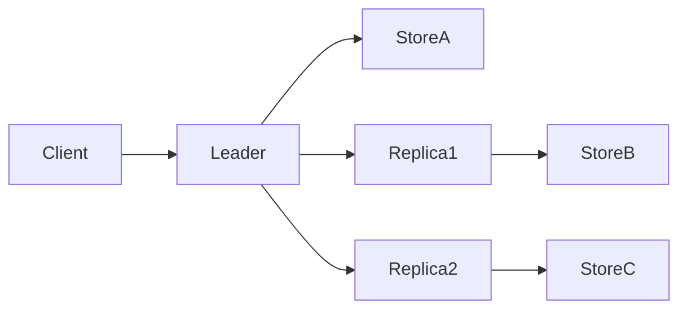

# DistKV

<div align="center">


</div>

A lightweight distributed key-value store built in Go to explore leader/follower replication, TCP networking, versioned snapshots, and durable recovery.

## ✨ What this project does

- Stores values by key in a simple in-memory map
- Runs a leader node that accepts writes
- Replicates PUT and DELETE requests to healthy peers
- Periodically checks peer health with TCP `PING` / `PONG`
- Persists state using a write-ahead log and snapshot compaction
- Recovers from disk on restart by replaying WAL data after the last snapshot

## 🏗️ Architecture



The leader is the source of truth for writes. Followers keep their local store in sync by polling the leader and applying a snapshot when their version is behind.

## 📚 Documentation

The project is organized by code area:

- [docs/cluster-overview.md](docs/cluster-overview.md) — documentation index
- [docs/server/leader.md](docs/server/leader.md) — leader lifecycle and request flow
- [docs/server/follower.md](docs/server/follower.md) — follower startup and sync flow
- [docs/server/helpers.md](docs/server/helpers.md) — config, protocol, and peer forwarding helpers
- [docs/store/core.md](docs/store/core.md) — main store implementation
- [docs/store/persistence.md](docs/store/persistence.md) — WAL and snapshot persistence

## 🗂️ Repository layout

```text
.
├── cmd/
│   └── server/            # CLI entrypoints for server processes
├── docs/                  # grouped project documentation
├── server/
│   ├── server.go          # leader logic and health checks
│   ├── nodes.go           # follower sync and handling
│   ├── helpers.go         # config + request protocol helpers
│   └── config-*.json     # per-node config files
├── store/
│   ├── store.go           # key/value store logic
│   └── db.go              # snapshot + WAL persistence helpers
├── snapshot/              # current snapshot files
├── Dockerfile             # container build definition
├── Makefile               # common task shortcuts
├── distkv.yaml            # project config or example config
├── go.mod                 # Go module definition
├── README.md              # this file
└── .gitignore             # repo ignores
```

## 🚀 Quick start

Start the leader and replicas in separate terminals:

```bash
go run ./cmd/server/ server/config-primary.json
go run ./cmd/server/ server/config-replica1.json
go run ./cmd/server/ server/config-replica2.json
```

Then interact with the leader over TCP:

```bash
printf "PUT|/color|blue\n" | nc localhost 8081
printf "GET|/color\n"     | nc localhost 8081
printf "DELETE|/color\n"  | nc localhost 8081
```

Check a replica:

```bash
printf "GET|/color\n" | nc localhost 8082
```

## ⚙️ Configuration

Each node reads a JSON config file.

```json
{
  "role": "replica",
  "address": ":8082",
  "peers": [":8081"],
  "leader": ":8081"
}
```

Fields:

- `role` — node role such as `primary` or `replica`
- `address` — TCP listen address for the node
- `peers` — peers the leader will forward writes to
- `leader` — leader address a follower uses for sync checks

## 🔄 Sync and persistence model

### Snapshot format

Each node stores a JSON snapshot with:

- `version` — current mutation count
- `timestamp` — last snapshot time in nanoseconds
- `data` — key/value map

Example:

```json
{"version":2,"timestamp":1785735782610875224,"data":{"/color":"blue","/animal":"dog"}}
```

### Replica sync flow

On startup, a follower sends `SYNC|<version>` to the leader:

1. The leader compares the follower version to its own.
2. If versions match, it replies with `SYNC_OK`.
3. If versions differ, it replies with `SYNC_DATA|<snapshot JSON>`.
4. The follower applies the snapshot and becomes aligned with the leader.

### WAL recovery

The store keeps a write-ahead log for recent mutations. On restart, it loads the most recent snapshot and replays WAL entries written after that snapshot, preserving the latest state without losing recent writes.

## 🧵 Wire protocol

Requests are newline-terminated and pipe-delimited. Special characters are escaped so they survive transport and storage cleanly.

| Raw value | On the wire |
|-----------|-------------|
| `|` | `\|` |
| `\` | `\\` |
| newline | `\n` |

Example frames:

- `PUT|/color|blue\n`
- `GET|/color\n`
- `DELETE|/color\n`
- `SYNC|42\n`

## 🧪 Testing

To run the Go test suite:

```bash
go test ./...
```

## ✅ Notes

This project is intentionally small and educational: it focuses on core distributed systems ideas such as replication, persistence, versioning, and recovery rather than production-grade consensus or sharding.

