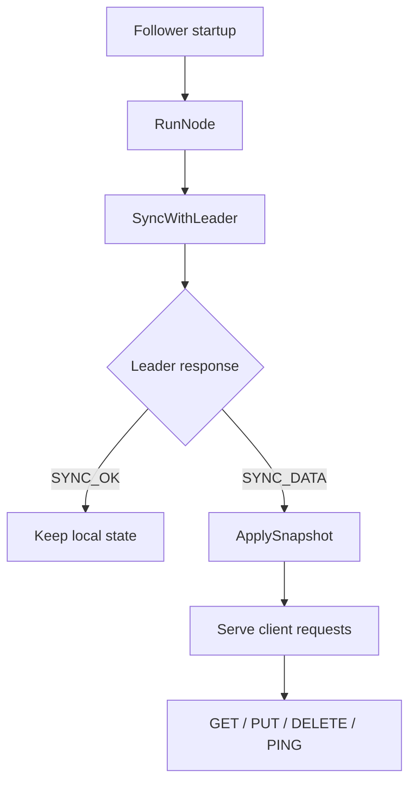

# Follower node flow

This document covers the follower-side behavior implemented in server/nodes.go.

## Overview

## Main entry point

### RunNode

The follower starts by loading its config and store, then binds a TCP listener. It starts a periodic sync loop with the leader and keeps the node alive by listening for incoming connections.

The sync loop runs once immediately and then every five seconds. This ensures the follower catches up with leader changes even if it was offline or behind for a while.

## Leader synchronization

### SyncWithLeader

This helper opens a TCP connection to the configured leader, sends a SYNC request with the follower's current version, and waits for the response.

If the leader returns a snapshot payload, the follower calls ApplySnapshot on its local store. This overwrites its in-memory state and persists the snapshot to disk, but does not truncate the follower's WAL. Existing follower WAL records can therefore be replayed over the snapshot after a later restart.

This keeps follower state close to leader state without needing a full rewrite of the replication protocol.

## Request handling

### HandleNodeConnection

This function processes a single request from a client or another peer. It reads one line, validates the request shape, and handles:

- GET
- PUT
- DELETE
- PING

Unlike the leader, the follower does not replicate writes to other peers. It simply serves local state and responds to health checks.

### GET behavior

The follower looks up the requested key in its local store. If it is absent, it returns an error.

### PUT behavior

The follower stores the value locally, then returns a success message.

### DELETE behavior

The follower removes the key from its local store and returns a success message.

### PING behavior

The follower responds with PONG so the leader can verify its availability during health checks.

## Role in the system

Followers are not the source of truth. They are local data mirrors that respond to read requests and periodically reconcile with the leader. The leader remains responsible for authoritative writes and replication decisions.
