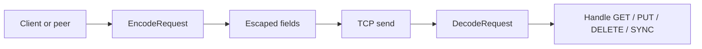

# Shared server helpers

This document covers the protocol and utility code in server/helpers.go.

## Protocol flow

## Config model

### Config

The Config type holds the cluster settings loaded from JSON:

- Role
- Addr
- Peers
- Leader

This is the bootstrap info used to decide how each node behaves when it starts.

### Snap

Snap is a lightweight wrapper around the persistent store. It gives the rest of the server package a consistent object for handling reads and writes while still keeping storage logic separate in the store package.

## Request protocol

The project uses a custom line-based protocol with escaping. It is not a fully generalized RPC layer; it is a compact format tuned for a small distributed key/value system.

### Encoder

Encoder escapes special characters so fields remain parseable when sent over the network or written to storage.

It escapes:

- `|` as `\|`
- `\` as `\\`
- newline as `\n`

### EncodeRequest

This helper turns a method and data fields into a request string like:

- `PUT|key|value\n`
- `GET|key\n`

The leader and follower both rely on this format for request handling and peer replication.

### DecodeRequest

DecodeRequest reverses the encoding and produces a slice of fields. It is used both for network traffic and for WAL parsing logic in the store package.

## Config and store bootstrapping

### LoadSnap

This helper creates a new Store instance from disk and wraps it in a Snap. This keeps the startup path simple for both leader and follower nodes.

### LoadConfig

This reads the JSON config file and unmarshals it into the Config struct.

## Peer forwarding

### ForwardToAllPeers

This sends a mutation to all healthy peers listed in the registry. It does so by putting each encoded request on that peer's channel. If a channel is full, the function drops the request with a warning instead of blocking the process.

### ForwardRawToPeer

This helper opens a TCP connection to a specific peer and writes a prebuilt request payload directly to it. This is used by the background goroutine created in RunServer.

## Why this matters

This helper layer is what makes the cluster protocol consistent across network communication, mutation forwarding, and persistence. Without it, peer messages and WAL entries would be ambiguous or unreadable whenever a key or value contained special characters.
