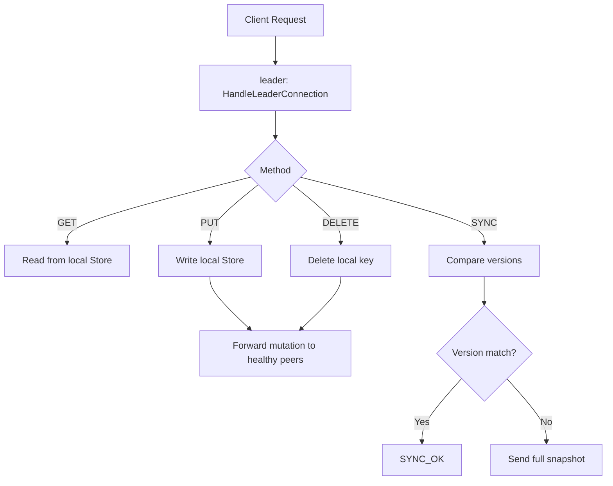

# Leader server flow

This document covers the behavior implemented in the leader-side logic in server/server.go.

## Overview

## Main entry point

### RunServer

The leader starts by loading the JSON configuration and binding a TCP listener to the configured address. Once the listener is active, it initializes a peer registry that tracks whether each peer is alive and which request queue belongs to it.

Each configured peer gets:

- an alive flag
- a request channel
- a goroutine that consumes queued requests and forwards them to that peer

If forwarding fails, the peer is marked dead in the registry.

Then the leader starts a background health-check loop and loads the snapshot/WAL state from disk. After that, it accepts incoming TCP connections and handles each one in its own goroutine.

## Health monitoring

### healthCheckEngine

This loop calls healthCheck once immediately and then every minute. The result is written into the registry so that the leader knows which peers are currently healthy enough to receive forwarded writes.

### writeReg

This helper updates the registry map of alive peers. Healthy peers are marked true, dead ones false.

### healthCheck

This function dials each peer on its local TCP address and sends a PING request. If the peer responds with PONG, it is considered healthy. Otherwise it is marked dead.

The implementation uses a buffered result channel so all peer checks can run concurrently while the leader waits for all results before returning.

## Request handling

### HandleLeaderConnection

This is the main leader-facing request loop. It reads one line at a time from the connection, enforces a maximum payload size, and decodes the request into fields.

It supports:

- GET
- PUT
- DELETE
- SYNC

### GET flow

The leader fetches the key from the local store. If it is missing, it responds with an error. Otherwise it writes the current stored value back to the client.

### PUT flow

The leader validates that the request includes both a key and a value. After writing to the local store, it forwards the mutation to all healthy peers using ForwardToAllPeers, then returns a success message to the client.

### DELETE flow

The leader deletes the key from the local store and then forwards the delete operation to healthy peers.

### SYNC flow

When a follower or node asks for synchronization, the leader compares the provided version with its own version. If the versions match, it responds with SYNC_OK. If they differ, it sends the full snapshot as a serialized JSON payload.

## Important design point

The leader is the write authority. It mutates local state first, then propagates the same mutation to other peers. This keeps the cluster behavior consistent and makes the store version a useful synchronization marker.
