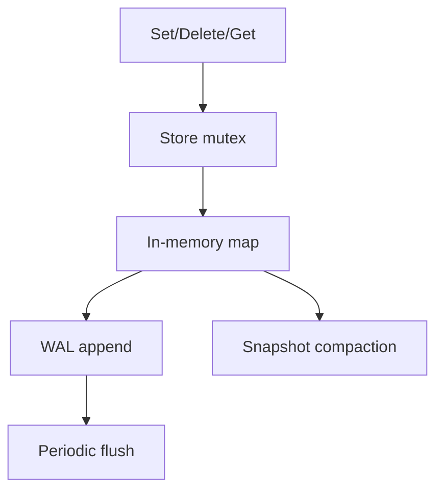

# Core store implementation

This document covers the in-memory store logic in store/store.go.

## Data flow

## Store structure

### Store

The Store struct owns the actual database state for a node. It contains:

- the key/value map
- a mutex for concurrency control
- path information for persistence files
- version tracking
- last saved timestamp
- the WAL file handle
- a channel for async WAL writes
- shutdown coordination via WaitGroup

This makes the store both thread-safe and durable enough to survive restarts.

## Construction and startup

### NewStore

NewStore creates the parent directory for persistence files, opens the WAL file, initializes the in-memory map, and loads persisted state from disk.

It also starts two background workers:

- walFlusher
- StartCompaction

This is the lifecycle for an active store instance.

## WAL flushing

### walFlusher

This goroutine runs on a one-second ticker and calls flushLog periodically. It also handles queued WAL writes from the log channel. The purpose is to ensure log writes reach disk and are not lost during a crash.

### flushLog

This forces the WAL file to sync with disk. It is the direct durability call used by the background logger.

## Compaction

### StartCompaction

This goroutine runs every five minutes. It writes a snapshot, then truncates the WAL so the log does not grow forever.

This is how the project keeps storage bounded while preserving a recoverable history.

## Core operations

### Get

Returns the value for a key and a boolean indicating whether the key exists.

### Set

Adds or updates a key/value pair, increments the version, and appends a WAL record.

### Delete

Removes a key, increments the version, and appends a delete record to the WAL.

### Snapshot

Serializes the current state to JSON for leader/follower sync. This is used when the leader sends state to a follower.

### ApplySnapshot

Replaces the local in-memory map with the incoming remote snapshot and writes it to disk. This is how a follower catches up after it has fallen behind.

## Shutdown

### Close

Close prevents new writes, closes the log channel, waits for background workers to finish, and closes the WAL file. This is the clean stop path for the store.

## Why the design works

The combination of in-memory state, frequent log syncing, and periodic snapshot compaction gives the project a simple but practical durable key/value model. It is not a full database engine, but it is a clear pattern for crash recovery and follower synchronization.
