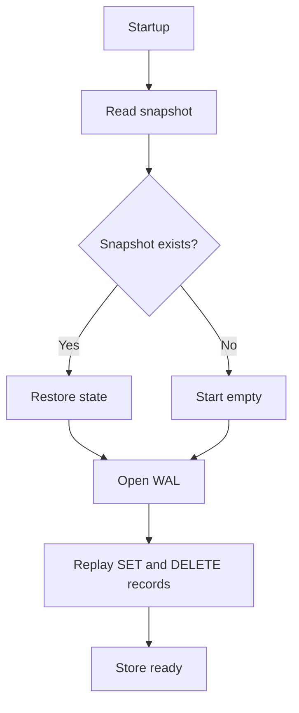

# Store persistence and recovery

This document covers the snapshot and WAL helper logic in store/db.go.

## Recovery flow

## Snapshot file format

### fileFormat

The snapshot format is a JSON object with:

- Version
- Timestamp
- Data

The Data field is a map of string key/value pairs. This is the on-disk representation of the current store state.

## Saving state

### save

This method creates a timestamp, serializes the current store as JSON, and writes it to the snapshot file. It is called as part of compaction.

### writeFile

The write path writes to a temporary file and renames it into place, which is a standard atomic-write pattern. This reduces the risk of leaving a half-written snapshot behind after a crash.

## Loading state on startup

### load

On startup, load first reads the snapshot file if it exists. If it is valid, the data is restored into memory and the version/timestamp are set from the file.

If the snapshot file doesn't exist, the code treats that as a normal empty store start. It then opens the WAL and replays every valid SET and DELETE record currently present. WAL records contain no snapshot version or timestamp, so replay is not filtered to operations known to follow the snapshot; replay updates data but does not increment the store version.

This means the store can recover after a restart by combining:

- the last compact snapshot
- all valid records still present in the WAL

Set and Delete enqueue records for a background writer and return without waiting for a file sync. The writer syncs periodically, so a sudden failure can lose recent acknowledged changes. Compaction also snapshots and truncates while WAL writes are managed by a separate goroutine; the implementation does not provide a transactional boundary between those steps.

Applying a remote snapshot replaces the in-memory data and writes the snapshot file, but does not truncate the local WAL. On a later restart, the existing WAL is replayed over that snapshot and may restore older local mutations.

## WAL replay

### decodeWAL

This helper decodes a WAL row back into fields. It uses the same escaping rules as the network protocol so values containing pipes, backslashes, or newlines remain intact.

During load, the system reads each WAL line and replays:

- SET operations by writing a key/value pair into memory
- DELETE operations by removing the key from memory

## Recovery model

The overall recovery strategy is deliberately simple:

1. load the snapshot, if present
2. replay valid records currently present in the WAL
3. continue serving requests

This keeps the system easy to reason about while still providing durability between compaction cycles.
